# Perigee(ペリジー)

<!-- 【画像】デモ動画のサムネイル(ホーム画面で惑星が並んでいる様子)。リンク先は YouTube のデモ動画 -->
<!-- [](【要記入:デモ動画の URL】) -->

> **まだ知らない、あなたのそばの惑星たち**
>
> 仲良くなれる可能性がある身近な人に気づける iOS アプリ

<p align="center">
  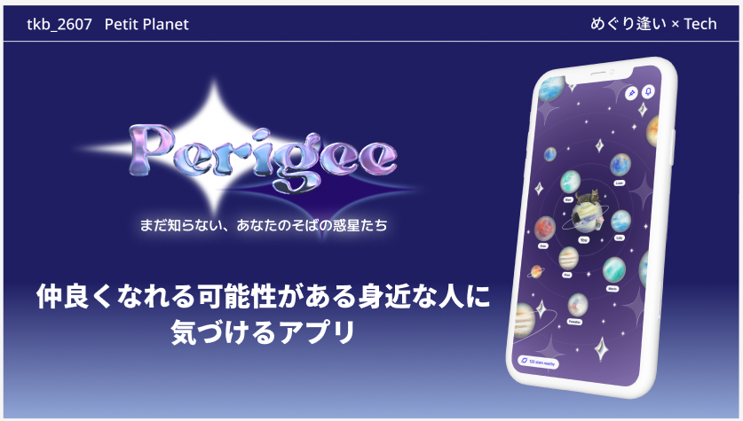
</p>

## 製品概要

### 背景(製品開発のきっかけ、課題等)

同じ授業やサークル、職場など、いつも近くにいるのに話したことがない人がいます。
顔は知っていて「仲良くなりたい」と思っても、話しかけるきっかけがないまま時間が過ぎていきます。

私たちはこの課題を確かめるため、日常の人とのつながりについて **2回のアンケート**(合計 113人、主に大学生)を行いました。（ともに2026年10月に、Google フォームで実施）

| 質問 | 1回目(40人) | 2回目(73人) |
| --- | --- | --- |
| 過去1か月に「何度か見かけるけれど、話したことがない人」がいた | **95%** | **90%** |
| 過去1か月に、まだ親しくない人と「仲良くなりたい」と思ったことがある | **95%** | **86%** |
| そう思った相手に、自分から話しかけたり連絡したりは「できないことが多い」「いつもできない」 | **65%** | **71%** |

<p align="center">
  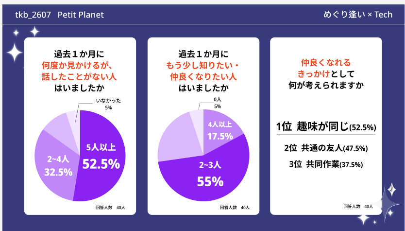
</p>

2回とも、**ほとんどの人が「仲良くなりたい人」が身近にいるのに、多くの人が自分からは行動できていない** という結果になりました。

行動できなかった理由(複数回答)も、2回で同じ傾向でした。

| 行動できなかった理由 | 1回目 | 2回目 |
| --- | --- | --- |
| 声をかけるタイミングがなかった | 55% | 62% |
| 迷惑だと思われそうだった | 45% | 49% |
| 相手が交流を望んでいるか分からなかった | 38% | 44% |
| 話題がなかった | 28% | 26% |
| 共通点が分からなかった | 23% | 15% |

自由記述にも、次のような声がありました。

> 同じ講義を受けているが、全く関わる機会がない人がたくさんいるので、そういう人たちと親睦を深めてみたいと思った。

> 既にグループで行動している人の中で話したい人がいても、中々2人きりで話せたりすることがないので話せていない。

「仲良くなりたい気持ち」はあるのに、**きっかけ・相手の気持ち・共通点** が見えないことが壁になっています。
今ある SNS やマッチングアプリは、すでにつながっている人か、遠くの知らない人と出会うためのもので、
「身近にいるけれど、まだ仲良くない人」との 0→1 をつくる仕組みはほとんどありません。

<p align="center">
  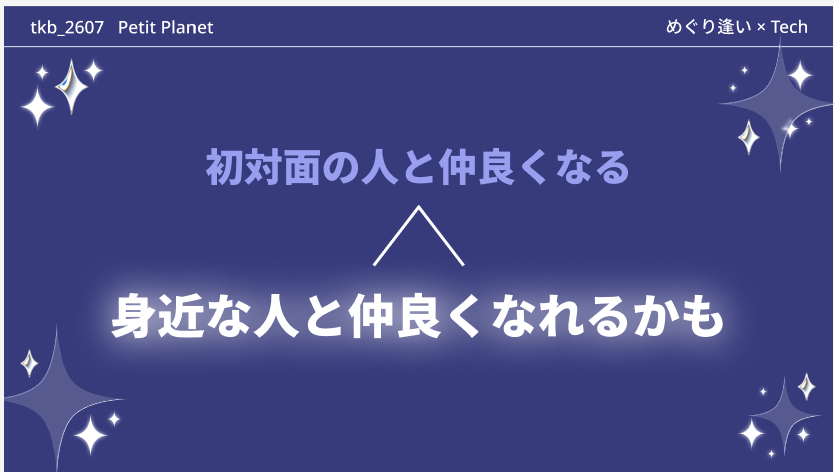
</p>

### 製品説明(具体的な製品の説明)

Perigee では、ユーザー1人ひとりが自分を表す **惑星** を持ちます。

- **惑星**:好きなものの写真の色と雰囲気から、水彩・クレヨン・パステルの画風で自動で描かれます。大きさと、惑星を押したときに鳴る **効果音** も選べます
- **衛星**:好きなものの写真を切り抜いたもので、自分の惑星の周りを回ります
- **プロフィール**:ニックネーム・本名・年代・性別・ひとこと・所属団体・タグを登録します。本名は、本人と、すれ違いが5回以上になった相手にしか見えません。年代は生年月日の代わりに登録するので、細かい個人情報を入れずに済みます
- **ホーム**:自分の惑星を中心に、周りの人の惑星が浮かぶ宇宙です。**関係が強い人ほど自分の近くに** 来ます
- **惑星の詳細**:ホームで惑星を押すと、その人の惑星を大きく見られます。惑星を押すとその人の効果音が鳴り、横になぞると衛星が回ります。すれ違いが5回以上になると、ニックネームの代わりに **本名** が表示されます
- **ピン止め**:気になった惑星は、詳細画面からピン止めしておけます。ホーム右上のピンのボタンから、この1週間にピン止めした惑星を新しい順に見返せます

関係の強さ(引力)は、次の3つから計算します。

- iPhone 同士が近くに来たことを Bluetooth で検知した **すれ違いの回数**
- 大学名・サークル名などの **タグ** の重なり
- 会社や職場などの**所属団体** が同じかどうか

引力の仕組みはユーザーには見せません。
「よくすれ違う気がする人」「なぜか近くに浮かんでいる人」として、自然に気になる存在になります。

| ホーム | 惑星の詳細 | ピン止めした星 | プロフィール |
| :---: | :---: | :---: | :---: |
| 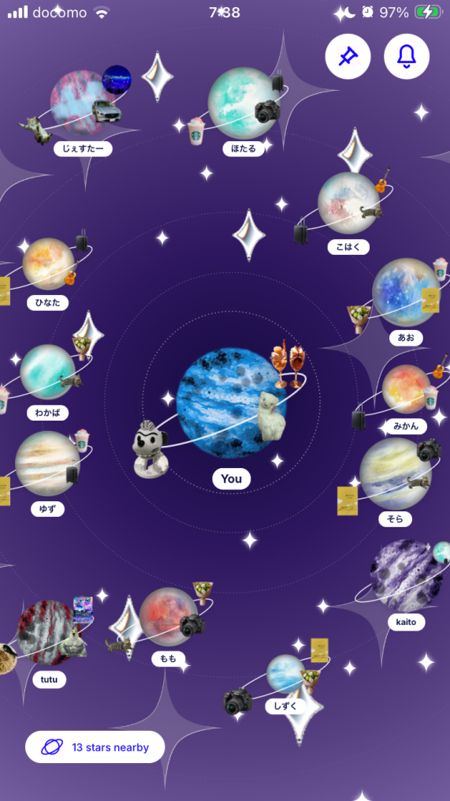 | 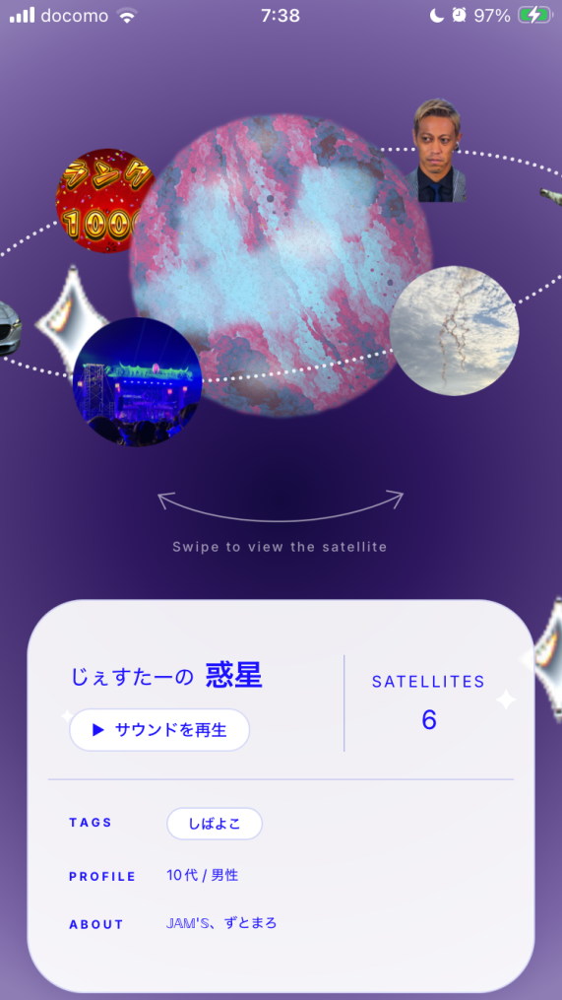 | 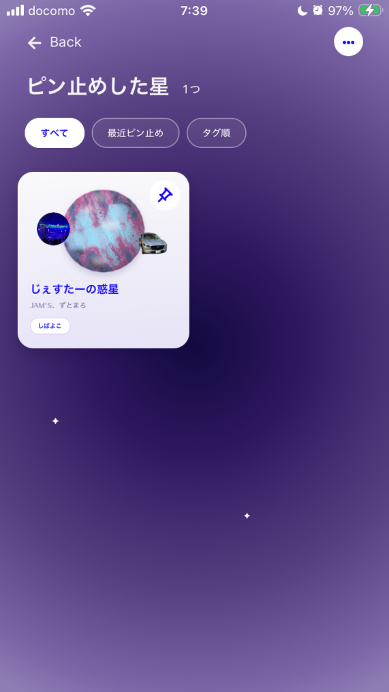 | 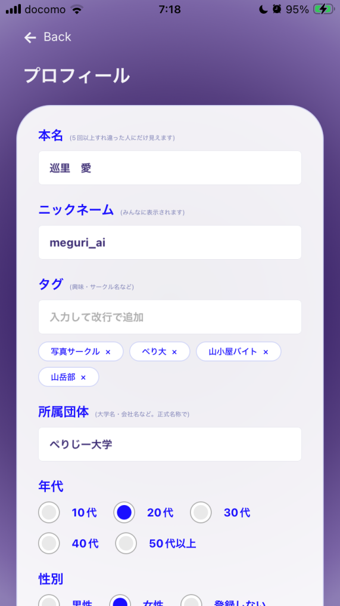 |

### 特長

#### 1. すれ違うほど、惑星が近づいてくる

iPhone 同士が近くに来ると Bluetooth で「すれ違い」を記録します。
すれ違うほど、その人の惑星が自分の近くに引き寄せられます。
顔ぶれは週に1回入れ替わり、そのあいだは30分ごとに惑星との距離だけが変わります。
毎週新しい出会いがありつつ、よく会う人は少しずつ近づいてきます。

<p align="center">
  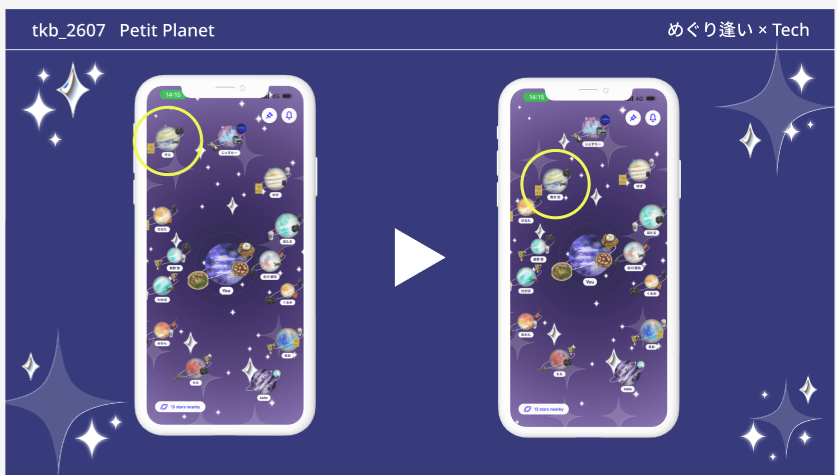
</p>

#### 2. 写真から、自分だけの惑星が生まれる

好きなものの写真を選ぶと、その色と雰囲気から惑星が描かれます。
画風は水彩・クレヨン・パステルの3種類から選べます。
好きなものの写真は被写体の形に切り抜かれ、衛星として惑星の周りを回ります。
惑星と衛星を見るだけで、相手が何を好きなのかが伝わります。

| 好きなものの写真を選ぶ | 画風を選ぶ(水彩・クレヨン・パステル) | 衛星と惑星の大きさを決める |
| :---: | :---: | :---: |
| 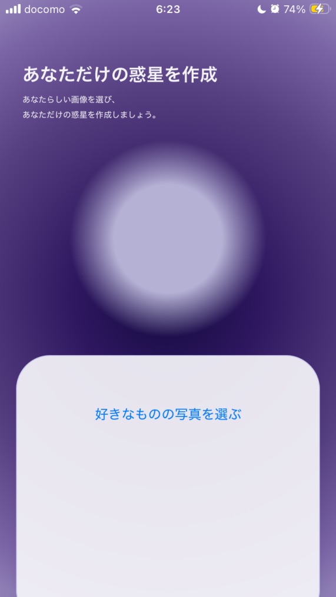 | 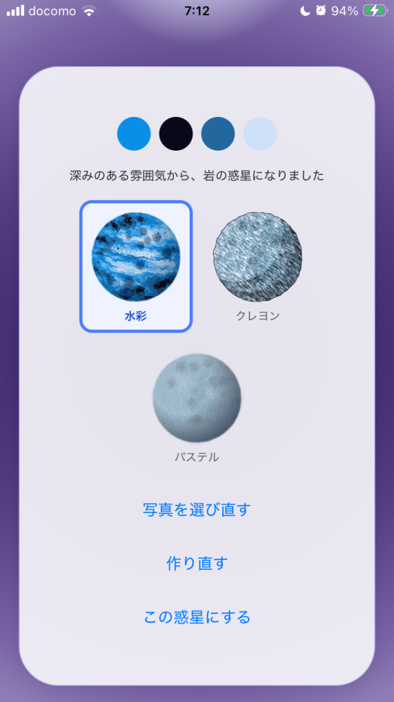 | 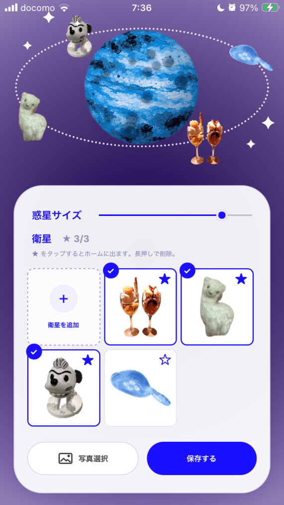 |

#### 3. 地図のように動かせる宇宙

ホームは指でつまんで拡大・縮小、なぞって移動できます。
地図アプリで土地と建物が一緒に動くように、惑星・軌道・星空が一体になって動きます。

<!-- 【画像】ズーム・パンの GIF -->

### 解決出来ること

アンケートで多かった「行動できなかった理由」に、それぞれ次のように応えます。

| 行動できなかった理由 | Perigee での解決 |
| --- | --- |
| 声をかけるタイミングがなかった | すれ違うたびに相手の惑星が近づき、「何度も会っている人」が自然に目に入る。話しかける前に、相手を知る時間をつくる |
| 迷惑だと思われそうだった<br>相手が交流を望んでいるか分からなかった | 惑星が並ぶのは、同じアプリを使っている人どうし。「新しい人と知り合いたい」気持ちを持った相手だと分かる |
| 話題がなかった<br>共通点が分からなかった | 衛星(好きなものの写真)とタグで、相手の好きなものや所属が分かる。会話の入り口になる |

アンケートでは、仲良くなりたいと思うきっかけとして「相手と同じ趣味があった時」(1回目 53%、2回目 44%)と
「既に仲が良い人との繋がりで」(1回目 48%、2回目 44%)が上位でした。
Perigee は、衛星で **好きなもの** を、タグと所属団体で **共通のつながり** を見せることで、このきっかけを生活の中でつくります。

- 相手を検索したり評価したりせず、**生活の中で自然に近づく** ので、気まずさや押しつけがましさがありません
- 本名は、すれ違いが5回以上になった相手にだけ見えます。引力の仕組みも見せないので、**少しずつ知り合える** 安心感があります

### 今後の展望

- iOS で両方がバックグラウンドでもすれ違いを検知できるようにお互いのIDの取得の仕方を工夫する
- 他の人の惑星が素敵だと思ったときに、相手にだけ見えるようにきらめき（いいね）を贈られるようにする（通知機能）
- すれ違いの「新しさ」も引力に反映する(最近よく会う人がより近くに来る)
- Android 対応、プッシュ通知(「近くに惑星が来ています」)

### 注力したこと(こだわり等)

- **引力が見た目で伝わる配置**:近さは関係の強さで決め、方向はひまわりの種の並び方を応用して決めています。強さの近い人が隣り合ったり、惑星が重なったり、片側に偏ったりしにくくしています
- **毎週の出会いと、毎日の変化を分けた**:顔ぶれと方向は週に1回だけ決めて保存し、あなたの惑星との距離だけを30分ごとに更新します。開くたびに配置が変わる落ち着かなさをなくしています
- **写真1枚で、その人らしい惑星**:AI を使わず、写真の色の特徴から惑星の種類と配色を決めます。同じ写真からは毎回同じ惑星ができます
- **Figma でデザイナーが作成したデザインをそのまま動かす**:宇宙の背景を層に分け、ズームしても星の大きさは変えず、位置だけが惑星と一緒に動くようにしています

## 開発技術

### 活用した技術

#### API・データ

- Supabase(PostgreSQL / Auth / Storage / RPC)
  - 全テーブルで行レベルセキュリティ(RLS)を有効にし、本名は本人しか読めない。すれ違いが5回以上の相手にだけ、RPC の中で本名を返す
  - 週ごとのホームの顔ぶれと方向を DB に保存(`home_lineups`)

#### フレームワーク・ライブラリ・モジュール

- Expo SDK 58 / React Native 0.88 / TypeScript / Expo Router
- @shopify/react-native-skia(惑星の生成、宇宙の背景の描画)
- react-native-reanimated 4 / react-native-gesture-handler 3(ズーム・パン)
- TanStack Query(データの取得とキャッシュ)
- expo-image-picker / expo-image-manipulator / react-native-image-colors(写真の読み込みと色の抽出)
- @six33/react-native-bg-removal(iOS の Vision による被写体の切り抜き)
- EAS Build(開発ビルドの配布)

#### デバイス

- iPhone(iOS 17 以上で被写体の切り抜きに対応)
- Bluetooth Low Energy(すれ違いの検知)

### 独自技術

#### ハッカソンで開発した独自機能・技術

**1. すれ違い検知の自作ネイティブモジュール**([`modules/perigee-ble`](./modules/perigee-ble))

CoreBluetooth を使い、1台の iPhone が発信と受信を同時に行う Expo モジュールを Swift で作りました。アプリを閉じていても、すれ違いを記録します。

- **2段構えの検知**:相手がアプリを開いていれば、Bluetooth の広告に入った ID を、接続せずにその場で読みます。相手がアプリを閉じていれば、接続して ID を読みます。どちらの状態でも、すれ違いを拾えます
- **iOS のバックグラウンドの制限への対策**:iOS は、アプリが裏にあるとき、同じ相手を1回しか知らせません。スキャンをやり直してこの記憶を消し、同じ人との次のすれ違いも拾えるようにしています
- **ID を15分ごとに切り替える**:交換する ID は、サーバーが発行する一時的なもので、15分で切り替わります。電波から特定の人を追いかけにくくしています
- **取りこぼさない報告**:報告に失敗したすれ違いは保存しておき、アプリを開き直したときに送り直します。ログアウトしたときは、前の人の分を送らないように捨てます
- **近くの人だけを数える**:電波の強さで、離れた相手は「すれ違い」に数えません
- コミット:`540561d`

**2. 引力の配置アルゴリズム**([`src/features/gravity/`](./src/features/gravity))

ホームでは、関係が強い人ほど自分の惑星の近くに来ます。配置は **距離** と **方向** を分けて決めています。

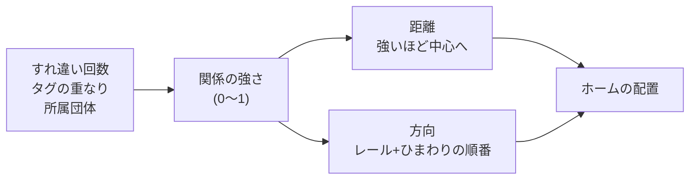

**(1) 関係の強さ(0〜1)**([`scoring.ts`](./src/features/gravity/scoring.ts))

| 材料 | 計算 | 重み |
| --- | --- | --- |
| すれ違い回数 | 対数で 0〜1 にそろえ、15回で頭打ち。何度も会うほど近づくが、1人だけ極端に近づきすぎない | 0.5 |
| タグの重なり | 共通のタグの数 ÷ 2人のタグを合わせた数(Jaccard 係数) | 0.3 |
| 所属団体 | 同じなら 1、違えば 0 | 0.2 |

候補者どうしを比べた相対値ではなく、**1人ひとりの絶対値** にしています。誰かとのすれ違いが増えても、ほかの人の位置は動きません。

**(2) 距離**([`radius.ts`](./src/features/gravity/radius.ts))

- 強さが 1 に近いほど中心に、0 に近いほど外側に置きます
- 一番外側の距離は方向ごとに変わり、**端末で実際に見えている範囲の端** までです。縦長の画面では、縦の方向ほど遠くまで広がります
- 画面右上のボタンや左下の表示にはかからない手前で止めます。四隅は角を丸め、どの方向でも惑星の約25%以上が画面に入るようにしています

**(3) 方向**([`angular-layout.ts`](./src/features/gravity/angular-layout.ts))

方向は、次の3つを満たすように決めます。

- 片側に偏らない
- 強さの近い人(=距離の近い人)が隣に並ばない
- 惑星どうしが重ならない

d3-force のような物理シミュレーションは使わず、決まった手順で計算します。

1. **放射状のレール**:人数分のレールを、中心から等間隔に引きます。1本のレールには1人だけが乗るので、方向が偏りません
2. **ひまわりの順番で割り当て**:強い順に、レールを「人数 ÷ φ²(φ は黄金比)」本ずつ飛ばして割り当てます。ひまわりの種が重ならずに並ぶのと同じ考え方です。13人なら5本ずつ(約138°ずつ)回り、**隣り合う人の強さの順位の差は必ず5か8** になります
3. **入れ替えで仕上げ**:実際に置いた位置で「重なり」と「距離が似た人が隣」を点数にし、点数が下がる2人の入れ替えを繰り返します。重なりのほうを重く見ます
4. **少しずらす**:レールの上にぴったり並ぶと時計の文字盤のように見えるので、レールの間隔の ±15% だけ方向をずらします。ずらす量は userId から決めるので、毎回同じです

乱数を使わないので、**同じ顔ぶれなら何度開いても同じ配置** になります。

**(4) 週に1回と、30分ごと**

- 表示する人の顔ぶれと方向は、**週に1回**(月曜 0:00)だけ決めて、サーバーに保存します
- そのあいだは、**30分ごと** に距離だけを計算し直します
- よくすれ違う人の惑星は、同じ方向のまま少しずつ近づいてきます。開くたびに配置が入れ替わる落ち着かなさがありません
- 週ごとの顔ぶれには、関係のある人(すれ違い・共通のタグ・同じ所属団体)に加えて、**まだ関係のない人もランダムに数人** 入れます。思いがけない出会いが生まれる「偶然」の枠です

<!-- 【画像】配置アルゴリズムの図(放射状のレールと、ひまわりの順番の割り当て) -->

- コミット:`4004873`(方向の決め方)、`cb24140`(画面の縦長に合わせた距離)

**3. 地図のように動く宇宙(ズーム・パン)**

ホームは、指でつまむと拡大・縮小し、なぞると移動します。地図アプリで土地と建物が一緒に動くように、惑星と夜空が一体になって動きます。

**1つのカメラを、層ごとに違う方法で読む**([`use-viewport.ts`](./src/features/gravity/use-viewport.ts)、[`space-camera-layer.tsx`](./src/features/gravity/space-camera-layer.tsx))

2D のゲームや地図エンジンと同じく、**ワールド座標とスクリーン座標を分け、その間を「カメラ」(ビュー変換)でつなぐ** 作りにしています。

- **ワールド座標**:宇宙の中での置き場所。惑星の距離と方向、星や軌道の位置はここで決まり、ズームしても変わりません
- **スクリーン座標**:実際に画面に描く位置
- **カメラ**:ワールド座標をスクリーン座標に写す変換。拡大率 `zoom` と移動量 `translate` の2つだけを持つ、拡大と平行移動の変換(アフィン変換)です

画面の中心を `center` とすると、ワールド上の点 `p` は次の位置に描かれます。

```
screen = center + translate + zoom × (p − center)
```

指で操作して変わるのは `zoom` と `translate` だけです。各層はこの1つのカメラを読み、層ごとに必要な部分だけを使って描きます。

| 層 | カメラの使い方 | 拡大したとき | 地図アプリでいうと |
| --- | --- | --- | --- |
| 紫のグラデーション | カメラを使わず、スクリーン座標に固定する | 動かない | 空の色 |
| 軌道の点線 | 位置も大きさもカメラで写す | 一緒に大きくなる | 土地・道路 |
| 星の飾り | 位置はカメラで写し、大きさはスクリーン座標で決める | 位置だけ動き、大きさは変わらない | ピン・アイコン |
| 惑星 | 位置はカメラで写し、大きさは逆向きに縮めて 1〜1.6 倍に収める | 1.6 倍までは大きくなり、その先は間だけが広がる | ピン(押せる) |

惑星の大きさを止めて間だけを広げるので、惑星が密集した場所も、拡大すれば1つずつ見分けられます。

**操作のこだわり**([`viewport.ts`](./src/features/gravity/viewport.ts))

- **指の下が動かない拡大**:つまんだ指の真ん中にある点がその場に留まるよう、拡大率と移動量を同時に計算します
- **押せる範囲も見た目どおり**:惑星は押せる範囲ごと逆向きに縮めているので、拡大しても隣の惑星と押せる範囲を取り合いません
- **拡大してもぼやけない惑星**:惑星は、拡大したときの最大の倍率で細かく描いてから縮めておきます。ズームしても、画像・文字・輪が引き伸ばされてぼやけません
- **見切れた惑星まで縮小できる**:全員が見えていれば等倍が下限です。端で見切れている惑星があれば、その惑星が丸ごと入るところまで縮小できます。背景の星がない範囲が見えないよう、0.5 倍で止めます

**なめらかに動かす仕組み**

- 指の動き(react-native-gesture-handler)から出した拡大率と移動量を、Reanimated の値のまま Skia の描画に渡します
- 指を動かしているあいだは React の描き直しをせず、**UI スレッドだけ** で惑星と夜空を動かします
- 配置の計算(距離と方向)と、ズームの変形を分けているので、拡大・移動しても配置の計算はやり直しません
- 背景の画像はアプリの起動中に先に読み込んでおき、ホームを開いた瞬間から星まで表示します

- コミット:`9c5dc86`(ズーム・パン)、`e8d199d`(背景と一体で動く層)

**4. 写真から惑星を描く**([`src/features/photo/`](./src/features/photo))

好きなものの写真1枚から、その人らしい惑星を描きます。

- **AI を使わない惑星の種類分け**:写真から取り出した色の数値(色み・鮮やかさなど)としきい値だけで、海・岩・ガス・溶岩・氷の5種類のどれにするかを決めます。同じ写真からは、毎回同じ惑星ができます([`planet-traits.ts`](./src/features/photo/planet-traits.ts))
- **手描きの質感を残して、色だけを変える**:人が描いた水彩の画像の「明るさ」だけを使い、写真から取った色を、暗い所は濃い色・明るい所は淡い色に塗り直します(グラデーションマップ)。にじみや紙の質感はそのまま残ります([`planet-texture.ts`](./src/features/photo/planet-texture.ts))
- **5種類 × 3つの画風**:種類ごとの特徴(光る筋・極冠・大陸と雲・クレーターなど)と、水彩・クレヨン・パステルの画風を組み合わせて描き分けます
- **写真を端末の外に出さない**:色の取り出しも惑星の描画も、iPhone の中だけで行います
- **惑星の大きさを本人が変えられる**:上限は、ホームで惑星どうしが重ならない大きさから計算しています(コミット:`87f14cf`)
- コミット:`fa84997`

**5. 衛星の切り抜きと、立体的に回る軌道**

- **切り抜きの失敗に備える**:iOS の Vision で、写真の被写体の形に切り抜きます。切り抜けない写真は、2本指で拡大・移動できる円形のトリミング画面に切り替えます(コミット:`5038ad9`)
- **惑星の前後を通る衛星**:衛星の軌道は、惑星を囲む円を斜めから見た楕円として描きます。軌道の手前の半分は惑星の前を、奥の半分は惑星の後ろを通るので、衛星が立体的に回って見えます
- **指についてくる回転**:横になぞると、つかんだ衛星が軌道に沿って指についてきます。軌道が縦向きになる左右の端でも、指の動きを軌道の向きに直して自然に回します(コミット:`2b3350f`、`213183e`)

**6. 少しずつ知り合うためのプライバシー設計**

- **本名を出す条件をサーバーで判定**:本名は、本人しか読めない設定(行レベルセキュリティ)のまま保存しています。すれ違いが5回以上になった相手にだけ、サーバーの関数の中で本名を返します。アプリが改造されても、条件を満たさない人の本名は外に出ません(コミット:`87f14cf`)
- **追いかけられない・写真を出さない**:すれ違いの ID は15分ごとに切り替わり(1. を参照)、惑星をつくる写真は端末の外に出ません(4. を参照)

## 開発者向け

開発環境の準備と起動方法は [pre-README.md](./pre-README.md)、開発のルールは [CLAUDE.md](./CLAUDE.md) を参照してください。
